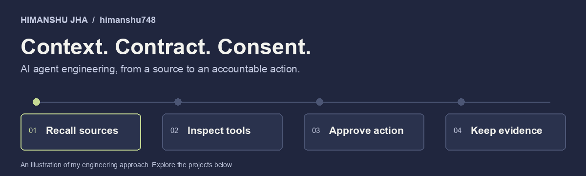

# Himanshu Jha

**AI agent developer · Memory systems · Developer relations**

I build agents that use tools, remember context, and ask before they act. My work spans native macOS apps, MCP and WebMCP interfaces, memory governance, durable workflows, and backend engineering. I also turn the failures and design decisions into technical guides developers can use.

I publish as **Himanshu Kumar** and **himanshu748**.

[Engineering portfolio](https://himanshu748.com/) · [Build case studies](https://himanshu748.com/builds/) · [DevRel portfolio](https://himanshu748.online/) · [Writing](https://dev.to/himanshu_748) · [LinkedIn](https://www.linkedin.com/in/himanshu748/) · [Resume](https://github.com/himanshu748/himanshu748/blob/main/resume/Himanshu_Kumar_DevRel_Resume.pdf) · [Email](mailto:jhahimanshu653@gmail.com)

<picture>
  <source media="(prefers-reduced-motion: reduce)" srcset="./assets/agent-systems.png">
  
</picture>

[Static diagram](./assets/agent-systems.png)

## Selected agent systems

### [OmniDev](https://github.com/himanshu748/omnidev) — a native agent for your Mac

Search files and screenshots with citations, edit code, and run tests through scoped tools and approval prompts. A shared local knowledge engine serves both the SwiftUI app and external MCP clients. Ollama mode runs inference locally; cloud inference is optional.

**SwiftUI · Python · FastAPI · SQLite · Ollama · MCP**  
[Engineering case study](https://himanshu748.com/builds/omnidev/) · [Product and real app recordings](https://himanshu748.com/omnidev/) · [Architecture](https://github.com/himanshu748/omnidev/blob/main/docs/ARCHITECTURE.md)

| System | The engineering problem | Start here |
| --- | --- | --- |
| **[Graft](https://github.com/himanshu748/graft-webmcp)** | Turn semantic HTML into reviewed WebMCP contracts; inspect evidence, export an adapter, and verify the deployed tools. | [Case study](https://himanshu748.com/builds/graft/) · [Workbench](https://graft-webmcp.vercel.app/) |
| **[ContextFirewall](https://github.com/himanshu748/ContextFirewall)** | Check recalled memory for stale facts, contradictions, secrets and missing evidence before assembling an agent's context. | [Case study and evidence](https://himanshu748.com/builds/contextfirewall/) |
| **[VOX](https://github.com/himanshu748/vox-zero-touch-os)** | Voice-to-plan support workflows with explicit approvals, persisted results and a spoken briefing. Built with Mastra, Temporal, Gemma and ElevenLabs. | [Case study](https://himanshu748.com/builds/vox/) · [Judge demo](https://getvox.tech/judge) — fictional tickets; customer sends are simulated |

## Writing that goes inside the system

- **[EmbodiWeave: my agent read its own failure and repeated it](https://dev.to/himanshu_748/embodiweave-my-agent-read-its-own-failure-and-repeated-it-so-i-made-the-graph-enforce-it-4cd9)** — graph-enforced memory, recorded decisions and fixed promotion gates in a robot simulation.
- **[ToolTrap: my support agent handed a customer a fake phone number](https://dev.to/himanshu_748/tooltrap-tool-results-are-data-wasnt-enough-25oh)** — untrusted tool results, held-out cases, legitimate-detail retention and scorer corrections.
- **[We instrumented an AI agent swarm with SigNoz](https://dev.to/himanshu_748/we-instrumented-an-ai-agent-swarm-with-signoz-and-its-own-telemetry-told-us-we-were-wrong-about-3fip)** — what telemetry changed about routing, model budgets and review quality.
- **[A trust firewall for my AI agent's memory](https://dev.to/himanshu_748/i-built-a-trust-firewall-for-my-ai-agents-memory-on-cognees-four-verbs-29g2)** — Cognee's memory lifecycle, provenance and the failures around recall.
- **[The smolagents bug that retried valid code three times](https://dev.to/himanshu_748/the-smolagents-bug-that-made-my-agent-retry-the-same-valid-code-three-times-2aka)** — a reproducible debugging story, recognized as a [DEV Summer Bug Smash runner-up](https://dev.to/devteam/congrats-to-the-summer-bug-smash-winners-50ei).

## Developer relations, backed by engineering

I help AI and developer-tool teams turn product capabilities into **working integrations, technical tutorials, API documentation, sample apps, and inspectable demos**. I work across Python, TypeScript, SwiftUI, FastAPI, React, SQL, MCP, WebMCP and OpenTelemetry.

Open to **AI agent engineering, developer relations, and technical writing contracts**. [Tell me what you're building →](mailto:jhahimanshu653@gmail.com)

## Open source and recognition

- [Merged contributions to Kestra](https://github.com/search?q=org%3Akestra-io+author%3Ahimanshu748+is%3Apr+is%3Amerged&type=pullrequests).
- [Flatpack](https://github.com/himanshu748/flatpack), a narrated-video-to-instructions prototype, placed **2nd in the Agent Builder track** at the [Livepeer Agent Hackathon 2026](https://atumera.com/hackathon).
- [AMD DevMaster 2026 Excellent Award](https://www.amd.com/en/developer/resources/technical-articles/2026/lessons-from-the-amd-devmaster-hackathon.html), listed under team **himanshu748**.

## Support the work

[GitHub Sponsors](https://github.com/sponsors/himanshu748) helps support more open-source tools and practical guides. Thank you to [Cap](https://github.com/CapSoftware), my first GitHub sponsor.
